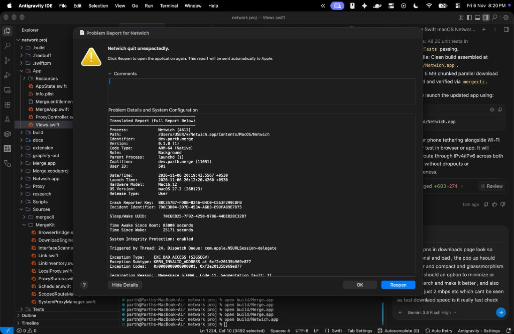
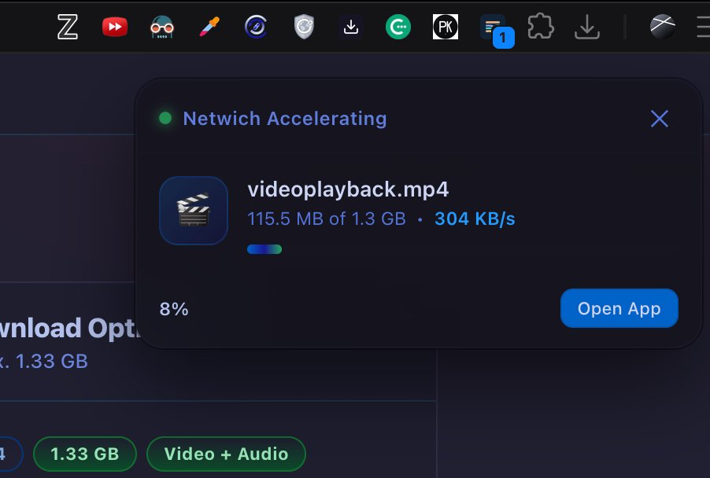
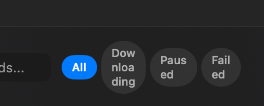
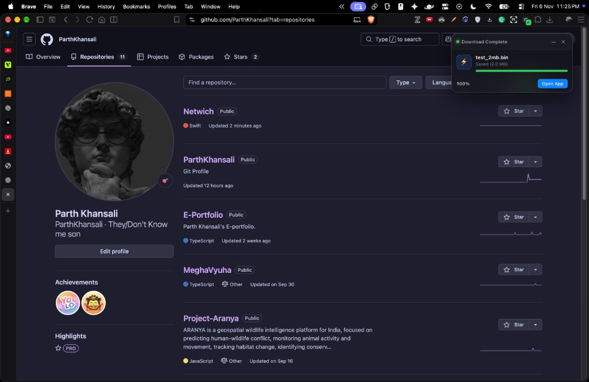
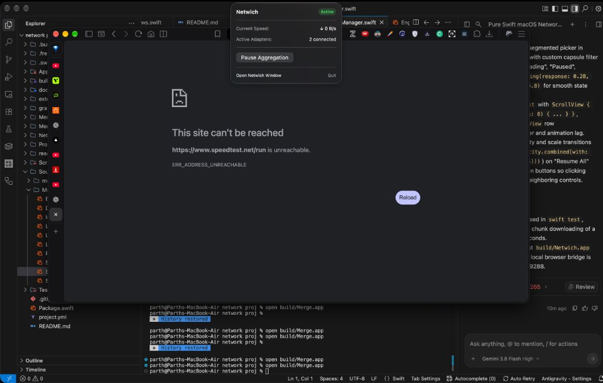

# Netwich: Stack Your Connections

[](LICENSE)
[](https://apple.com)
[](#)
[](https://swift.org)
[](#)

Netwich is a native macOS app that aggregates multiple internet connections (such as your home Wi-Fi and your phone's USB tether) to boost download speeds and provide seamless network failover.

Built in pure Swift with Apple's native design language. No cloud relays, no VPN subscriptions, and unprivileged userspace networking that costs nothing.



---

## Highlights

### 1. Multi-Path Internet Aggregation
- Combines outbound traffic across physical network interfaces (Wi-Fi, Ethernet, iPhone USB tether, Android USB tether).
- Runs an unprivileged, low-latency local SOCKS5 proxy on `127.0.0.1:1080` using `IP_BOUND_IF`.
- Weighted least-connections scheduler with real-time EWMA throughput sampling and continuous link health probing.
- Zero-downtime failover: if one connection disconnects, active downloads and browse sessions seamlessly continue through the remaining links.
- Automatic recovery on app quit or crash, ensuring system network settings are never left in an inconsistent state.

### 2. Accelerated Multi-Stream Downloader
- Splits large downloads into concurrent HTTP byte-range chunks (4, 8, 16, or 32 streams).
- Routes individual chunks across distinct network adapters to multiply throughput.
- Full pause and resume capability with persistent metadata stored in `~/Library/Application Support/Netwich/metadata/`.
- Safe single-stream fallback when servers do not support HTTP byte ranges.
- Drag-and-drop URL support directly onto the main window, clipboard link detection, and audio completion feedback.



### 3. Native Browser Companion & Floating HUD
- Chrome, Brave, Edge, Arc, and Firefox extensions included in `extension/` and embedded inside the app bundle.
- Lightweight HTTP bridge on `127.0.0.1:19288` (with fallback to 19289 and 19290).
- Floating download HUD appears in the browser only when a download starts, showing real-time speed, progress, and one-click access to Netwich.
- Support for `netwich://` and `merge://` native URL schemes for instant browser handoff.

<p align="center">
  
</p>



### 4. Native macOS Menu Bar Extra
- Real-time download rate indicator right in your menu bar.
- One-click aggregation pause/resume and quick link overview.

<p align="center">
  
</p>

---

## Getting Started

### Prerequisites
- macOS 14.0 or newer on Apple Silicon (M1/M2/M3/M4)
- Xcode Command Line Tools (`xcode-select --install`)
- `xcodegen` (`brew install xcodegen`)
- Node.js (for bundling the browser extension with esbuild)

### Build & Run

```bash
# 1. Run unit test suite (26 tests)
swift test

# 2. Build application bundle and browser extensions
./Scripts/build.sh

# 3. Launch Netwich
open build/Netwich.app
```

The compiled application bundle is generated at `build/Netwich.app` (with a `build/Merge.app` symlink for backwards compatibility).

### Command-Line Interface (`mergecli`)

Netwich includes a headless CLI tool for automated scripts and terminal use:

```bash
# Inspect all detected physical adapters and hardware flags
./.build/debug/mergecli links

# Test scheduler weights across active interfaces
./.build/debug/mergecli sched

# Check system network services proxy status
./.build/debug/mergecli systemproxy

# Download a file via parallel multi-chunk distribution
./.build/debug/mergecli download "https://proof.ovh.net/files/10Mb.dat"
```

---

## Installing the Browser Extension

1. **Chromium Browsers (Chrome, Brave, Edge, Arc)**:
   - Navigate to `chrome://extensions`
   - Enable **Developer mode** in the top right corner
   - Click **Load unpacked**
   - Select the `extension/chrome` directory in this repository
2. **Mozilla Firefox**:
   - Navigate to `about:debugging#/runtime/this-firefox`
   - Click **Load Temporary Add-on...**
   - Select `extension/firefox/manifest.json`

---

## Architecture

```
Netwich.app
├── Contents/MacOS/Netwich               # Main SwiftUI application binary
├── Contents/Resources/Netwich.icns      # macOS App Icon
├── Contents/Resources/netwichTemplate*  # Menu bar monochrome template icon
├── Contents/Resources/extension/        # Packaged Chrome & Firefox extensions
└── Contents/Library/System Extensions/  # System extension (optional)
```

- **`Sources/MergeKit/LocalProxy.swift`**: High-throughput SOCKS5 server with `IP_BOUND_IF` multi-link binding.
- **`Sources/MergeKit/SystemProxyManager.swift`**: Safe system-wide proxy configuration with auto-revert.
- **`Sources/MergeKit/DownloadEngine.swift`**: Resumable multi-chunk parallel download engine.
- **`Sources/MergeKit/BrowserBridge.swift`**: Local REST bridge connecting browser extensions to Netwich.
- **`Sources/MergeKit/Scheduler.swift`**: Dynamic link health, latency, and flow distribution engine.
- **`App/`**: Native SwiftUI interface with glassmorphism components and real-time waveforms.

---

## Author & License

- Designed and built by **Parth Khansali** ([@ParthKhansali](https://github.com/ParthKhansali))
- Open source under the [MIT License](LICENSE).
