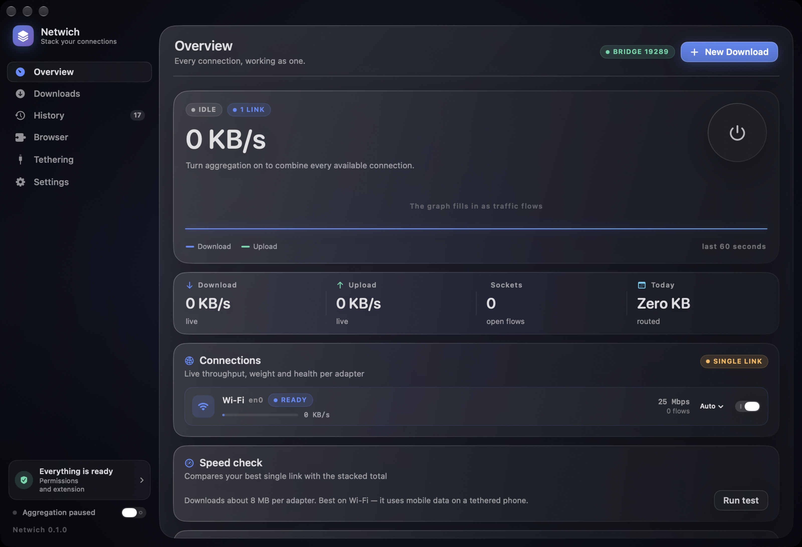
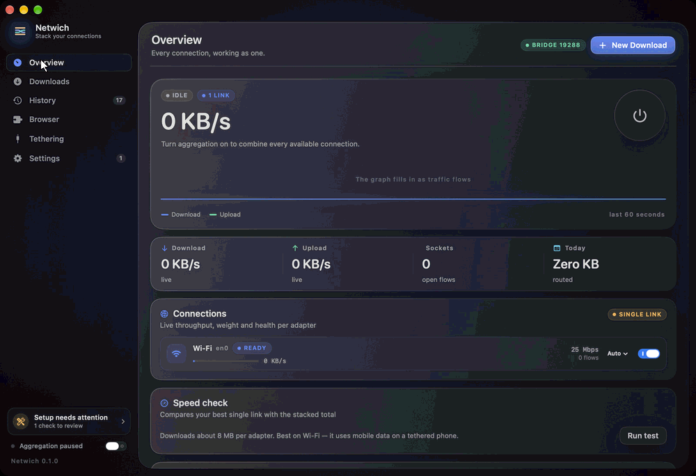
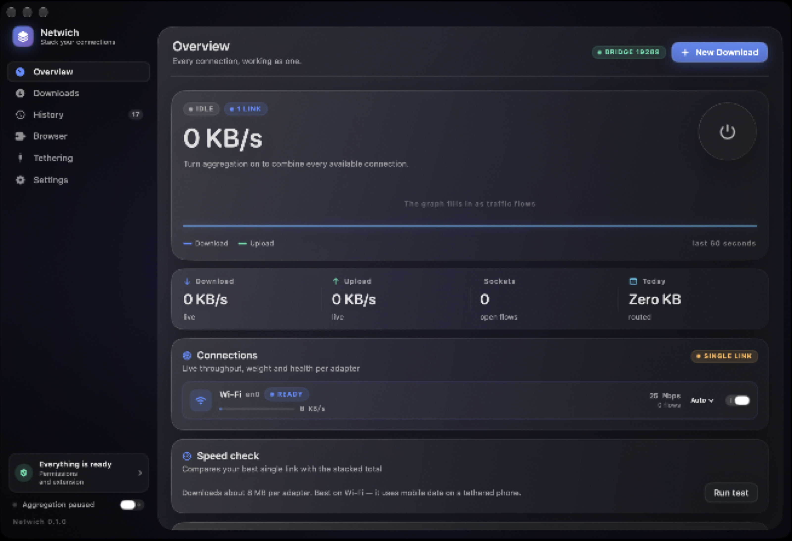
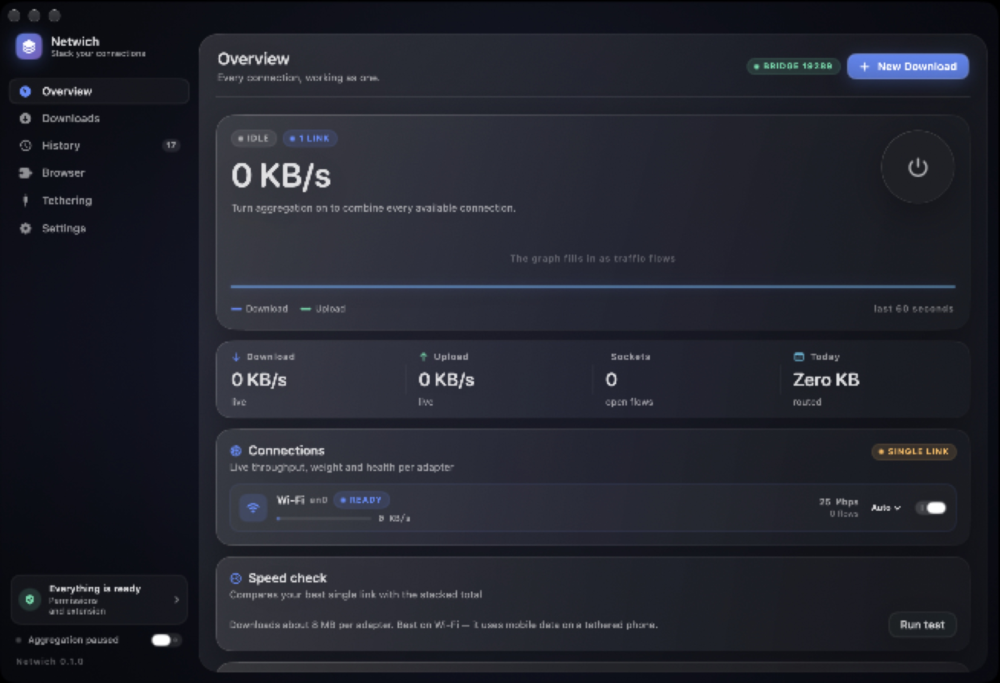
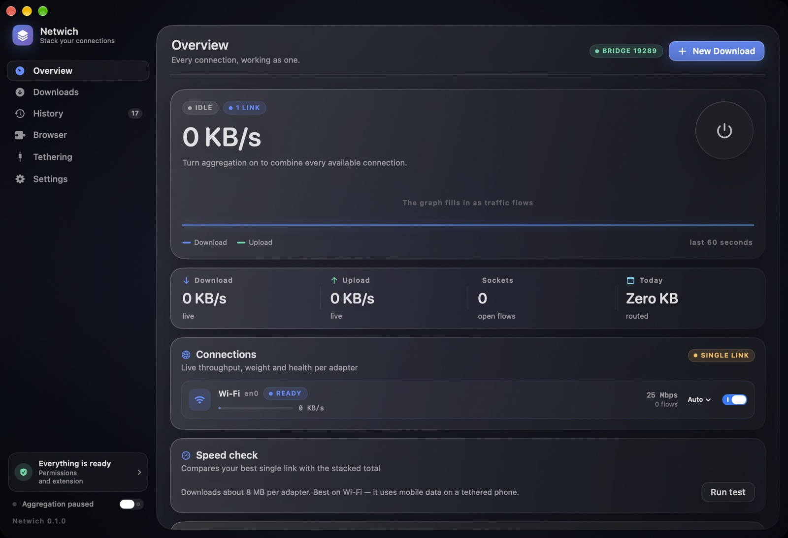
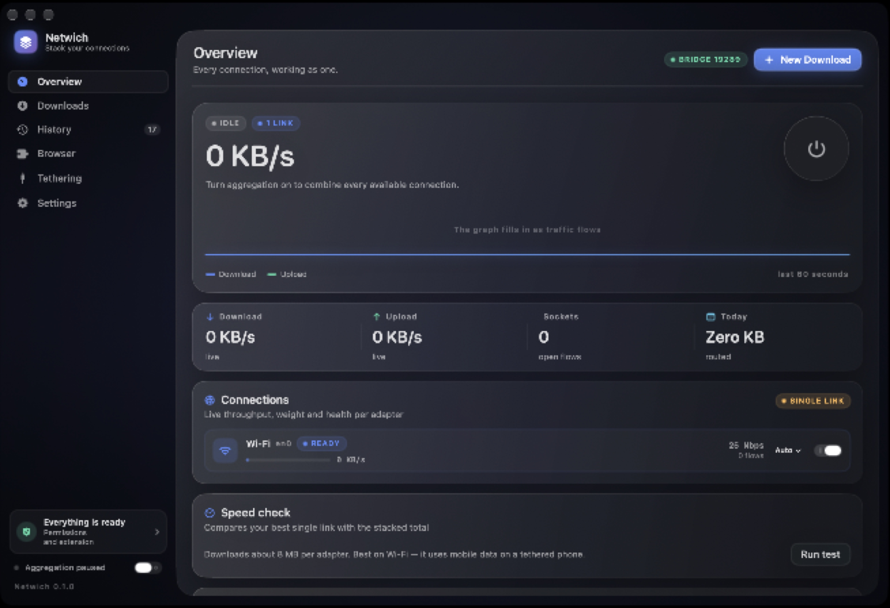

# Netwich

**Stack your connections.**

Netwich is a native macOS app that combines several internet links (such as home Wi-Fi and a phone
tether, or Ethernet and a hotspot) into one faster, failover-safe connection. It runs entirely
on your Mac: no account, no relay, no VPN subscription, no privileged daemon.

[](https://github.com/ParthKhansali/Netwich/actions/workflows/ci.yml)
[](https://github.com/ParthKhansali/Netwich/releases/latest)
[](LICENSE)
[](https://www.apple.com/macos/)
[](https://swift.org)
[](Tests)

<p align="center">
  
</p>

<details>
<summary><b>🎬 Click to preview interface walkthrough (animated)</b></summary>
<br/>
<p align="center">
  
</p>
</details>

## Download

Everything is on the [latest release](https://github.com/ParthKhansali/Netwich/releases/latest):

| File | What it is |
| --- | --- |
| **`Netwich-<version>.dmg`** | The macOS app. Open it, drag **Netwich** onto **Applications**. |
| **`Netwich-Extension-Chromium-<version>.zip`** | Browser extension for Chrome, Brave, Edge and Arc. |
| **`Netwich-Extension-Firefox-<version>.zip`** | Browser extension for Firefox. |
| `Netwich-Extensions-<version>.zip` | Both extensions plus `INSTALL.txt`. |

Requires macOS 14 or newer on Apple Silicon.

> **First launch.** Releases are ad-hoc signed, so macOS may say the app cannot be opened.
> Open **System Settings → Privacy & Security**, click **Open Anyway**, then confirm. Netwich's
> welcome screen has a button that opens that exact pane. On later versions with a Developer ID
> this step disappears.

## What it does

### One connection made of many

Netwich runs a local SOCKS5 proxy on `127.0.0.1:1080` and pins each outbound flow to a
physical interface with `IP_BOUND_IF`. A weighted least-connections scheduler spreads flows
across the links you enable, samples throughput continuously and takes a sick link out of
rotation without dropping the others.


### Downloads that use every link

Large files are split into ranged chunks and fetched in parallel across adapters. Pause,
resume across launches, and a verified-size check before anything is marked complete. Servers
without range support fall back to a single stream automatically.


### A browser extension, not a browser takeover

The extension adds a small floating HUD while a download runs and hands the URL to Netwich
over a loopback bridge. It is a separate download for each browser engine, with the exact
`chrome://extensions` / `about:debugging` steps shown in the app.



### Tethering without guesswork

A step-by-step panel for adding a phone as a second link, with the driver caveats that
actually matter and live detection of the new adapter.



### Permissions you can see

Onboarding probes the real state of your machine (bundle location, quarantine flag, admin
group, login item, bundled extension), and each row opens the matching System Settings pane.
Nothing is assumed, and nothing is requested that Netwich does not use.





## Permissions

| Permission | When | Why |
| --- | --- | --- |
| Administrator password (one system dialog) | Only when aggregation is turned **on** | `networksetup` is the supported way to point macOS's SOCKS proxy at Netwich and requires admin rights. All services change in one batch behind a single prompt. |
| Downloads folder | When a download starts | Files are written where you chose. |
| Login item | Optional, off by default | Start at login. Removable in System Settings → General → Login Items. |
| Browser extension | When you install it | Talks only to `127.0.0.1:19288-19290`. |

Netwich has no telemetry and contacts no service of its own. The only optional outbound
request it makes is the speed test, and only when you press **Run test**.

## Installing the browser extension

Browsers do not allow an app to sideload an extension, so this last step is manual by design.
The app shows the right address for your browser and a **Reveal extension folder** button.

**Chrome, Brave, Edge, Arc**: open `chrome://extensions` (`brave://extensions` in Brave),
enable **Developer mode**, click **Load unpacked**, choose the `chromium` folder.

**Firefox**: open `about:debugging#/runtime/this-firefox`, choose **Load Temporary Add-on...**,
select `firefox/manifest.json`. Temporary add-ons are removed when Firefox quits; permanent
installation requires signing at [addons.mozilla.org](https://addons.mozilla.org/developers/).

## How it works

```
App (SwiftUI)
 ├─ AppState ────────────── telemetry, persistence, orchestration
 ├─ PermissionCenter ────── live probes + System Settings deep links
 └─ Theme / Views ───────── glass surfaces, motion, charts

MergeKit (SPM)
 ├─ LocalProxy ──────────── SOCKS5 server, IP_BOUND_IF, flow accounting
 ├─ Scheduler ───────────── weighted least-connections, EWMA, health probes
 ├─ DownloadEngine ──────── ranged chunks, resume, verification
 ├─ BrowserBridge ───────── loopback REST with an origin allowlist
 ├─ SystemProxyManager ──── snapshot-first system proxy changes
 ├─ ProcessRunner ───────── deadlock-free subprocesses with timeouts
 └─ ScopedRouteManager ──── optional host routes (root only)

extension/{chrome,firefox,src}   MV3 manifests + shared TypeScript
Proxy/                           experimental NetworkExtension (not wired in)
```

**Security model**

- The SOCKS proxy binds loopback only.
- The bridge rejects every website `Origin` with `403` and never grants wildcard CORS, so a
  page you visit cannot read your download list or cancel transfers.
- Download filenames are reduced to a single path component before touching the filesystem.
- System proxy state is saved **before** the first mutation and restored exactly on quit or
  after a crash; recovery only touches our own `127.0.0.1:1080` entries.
- No credentials, tokens or analytics leave the machine.

Full findings and fixes are in [docs/ANALYSIS.md](docs/ANALYSIS.md).

## Performance

Measured on an Apple Silicon Mac with one window open and aggregation idle:

| Metric | Before the pass | After |
| --- | --- | --- |
| Idle CPU (`top`, 10 s sample) | 0.7-0.8% | **0.3-0.4%** |
| Memory footprint | ~95 MB | ~95 MB |

The wins came from a coalescing telemetry timer (tolerance + common run-loop mode), publishing
link rows only when values actually change instead of every tick, halving per-flow relay
buffers, and minifying the extension bundles. The telemetry loop is 1 Hz, the UI is fully
`@Observable`, and every subprocess lives behind `ProcessRunner` off the main actor.

## Build from source

```bash
brew install xcodegen
swift test                     # 25 hermetic tests
NETWICH_INTEGRATION=1 swift test   # + 6 tests that need real adapters and internet
./Scripts/build.sh             # Debug build in build/Netwich.app
./Scripts/package.sh           # Release DMG + extension ZIPs in dist/
```

Signing and notarisation are opt-in:

```bash
CODE_SIGN_IDENTITY="Developer ID Application: Your Name (TEAMID)" ./Scripts/package.sh
NOTARIZE=1 APPLE_ID=you@example.com TEAM_ID=TEAMID APP_PASSWORD=xxxx ./Scripts/package.sh
```

Node is only needed to re-bundle the extension's TypeScript. Compiled bundles are committed, so
an offline build still works.

### Command line

```bash
./.build/debug/mergecli links          # adapters, interfaces, hardware flags
./.build/debug/mergecli sched          # scheduler weights across active links
./.build/debug/mergecli systemproxy    # current system proxy state
./.build/debug/mergecli download URL   # parallel multi-chunk download
```

### Deep links

`netwich://tab/overview`, `…/downloads`, `…/history`, `…/browser`, `…/tethering`,
`…/settings` switch tabs. `netwich://download?url=…` queues a download.

## Known limitations

- **Ad-hoc signed.** Warning-free first launch needs an Apple Developer ID and notarisation.
- **TCP only.** SOCKS5 `UDP ASSOCIATE` is not implemented, so QUIC/HTTP3 traffic uses the
  default route.
- **One thread per proxy flow.** Fine for browsing and downloads; a `Network.framework` event
  loop is the next step for very high flow counts.
- The `Proxy/` system extension and `App/ProxyController.swift` are not wired into the app;
  the shipping path is `networksetup`.

## Project docs

- [CHANGELOG.md](CHANGELOG.md)
- [Engineering audit](docs/ANALYSIS.md)
- [Contributing](CONTRIBUTING.md)
- [Security policy](SECURITY.md)

## Author

Built by **Parth Khansali** ([@ParthKhansali](https://github.com/ParthKhansali)).

MIT licensed. See [LICENSE](LICENSE).
