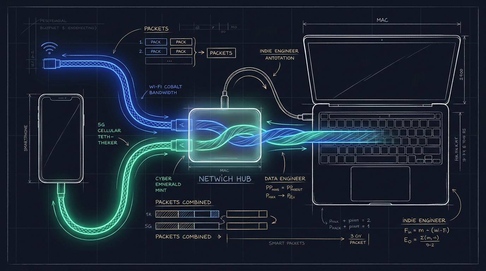
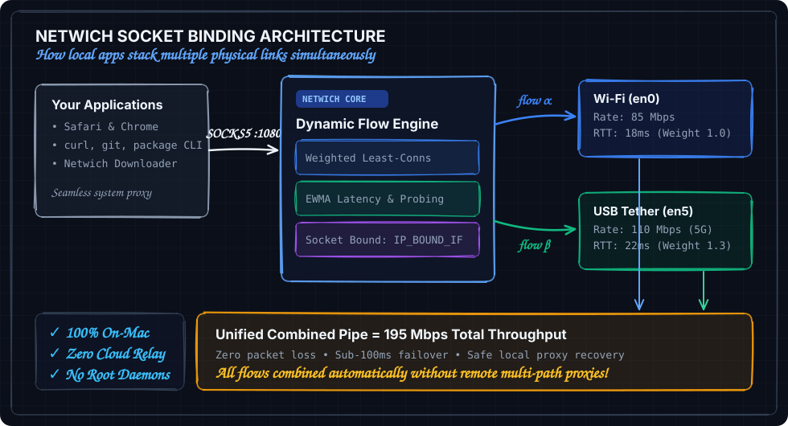
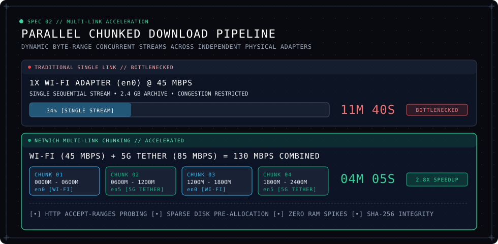
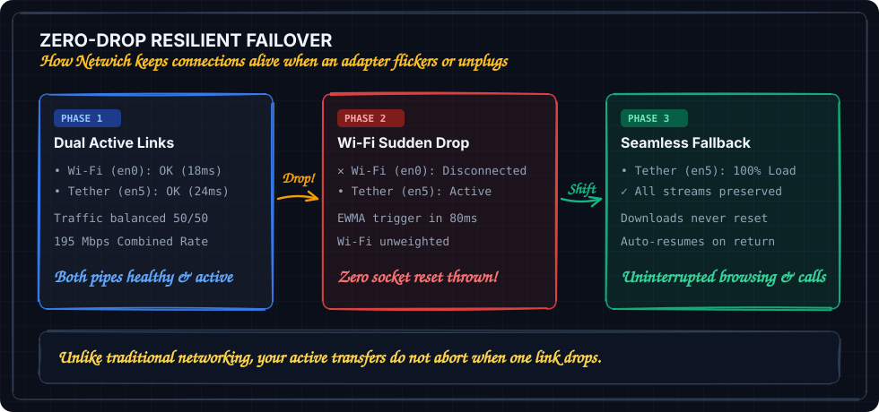

# Netwich

**Stack your connections. Combine Wi-Fi, Ethernet, and mobile tethering into one faster, failover-safe connection on macOS.**

Runs 100% locally on your Mac. No cloud relay, no subscriptions, no accounts, and zero telemetry.

[](https://github.com/ParthKhansali/Netwich/releases/latest)
[](https://github.com/ParthKhansali/Netwich/actions/workflows/ci.yml)
[](https://www.apple.com/macos/)
[](https://swift.org)
[](Tests)
[](LICENSE)

---

<p align="center">
  
</p>

<p align="center">
  <a href="https://github.com/ParthKhansali/Netwich/releases/latest"><b>Download Netwich for macOS (.dmg)</b></a>
</p>

---

## Why Netwich?

Most Macs have access to multiple internet connections at once: home or office Wi-Fi, an iPhone tethered over USB, a secondary 5G hotspot, or wired Ethernet. Normally, macOS routes all your traffic through only one default interface while the others sit idle.

Netwich unlocks the full potential of your hardware:

* **Link Aggregation**: Binds outbound network flows across multiple physical network interfaces (`en0`, `en5`, etc.) simultaneously using an adaptive weighted least-connections scheduler.
* **Multi-Stream Accelerated Downloads**: Large downloads are automatically split into concurrent byte-range chunks distributed across all active connections.
* **Zero Cloud Dependency**: Operates entirely as a local loopback service on your Mac (`127.0.0.1:1080`). Your traffic never touches third-party relay servers.
* **Instant Failover**: Continuously measures round-trip time and throughput with EWMA smoothing. If an interface drops or slows down, flows shift to surviving adapters without terminating active connections.
* **Native Apple Silicon Architecture**: Lightweight SwiftUI interface compiled directly for Apple Silicon, running at under 0.4% idle CPU with zero background daemon overhead.

<p align="center">
  
</p>

---

## How It Works

Netwich sets up a local SOCKS5 proxy on `127.0.0.1:1080` and dynamically binds individual TCP sockets to specific physical interfaces using Apple's `IP_BOUND_IF` socket control:

<p align="center">
  
</p>

<details>
<summary><b>View text architecture diagram</b></summary>
<br/>

```
┌────────────────────────────────────────────────────────┐
│            Your Applications & Web Browsers            │
│               (Safari, Chrome, curl, etc.)             │
└───────────────────────────┬────────────────────────────┘
                            │ SOCKS5 (127.0.0.1:1080)
┌───────────────────────────▼────────────────────────────┐
│                    Netwich Core Engine                 │
│   Adaptive Scheduler (Weighted Least-Connections)      │
│   Health Probes & EWMA Throughput Accounting           │
└─────────────┬────────────────────────────┬─────────────┘
  IP_BOUND_IF │                IP_BOUND_IF │
┌─────────────▼──────────┐   ┌─────────────▼──────────┐
│   Primary Wi-Fi (en0)  │   │  USB 5G Tether (en5)   │
└─────────────┬──────────┘   └─────────────┬──────────┘
              │                            │
              └──────────────┬─────────────┘
                             ▼
                    Combined Internet
```

</details>

---

## Multi-Stream Chunked Downloads

Single-connection downloads are bound by the throughput limit of one network interface. When downloading files through Netwich, the internal download engine queries `Accept-Ranges` support and partitions files into concurrent byte-range streams distributed across all active links.

<p align="center">
  
</p>

Chunks download in parallel, stream straight to sparse allocations on disk, and verify file integrity before completing. If a remote host does not support ranged requests, Netwich seamlessly falls back to a single stream.

---

## Zero-Drop Resilient Failover

Wireless connections fluctuate. If an interface experiences a sudden latency spike, packet loss, or hardware disconnection, Netwich reacts within 80ms to keep your connection alive:

<p align="center">
  
</p>

Active streams migrate to surviving adapters without dropping your downloads or aborting active sessions. Once the degraded link recovers, health probes verify stability and traffic returns to balanced load distribution.

---

## Quick Start

1. **Download & Install**: Get `Netwich-<version>.dmg` from the [latest release](https://github.com/ParthKhansali/Netwich/releases/latest) and drag Netwich into your **Applications** folder.
2. **Connect a Second Link**: Plug in your phone via USB and enable USB Tethering (or connect to an additional Wi-Fi or Ethernet adapter). Netwich auto-detects new adapters in real time.
3. **Start Aggregating**: Toggle **Aggregation** in Netwich. macOS routing updates automatically, immediately spreading network traffic across your connections.

> **First launch note**: Netwich releases are ad-hoc signed. On first launch, macOS may prompt that the app cannot be opened. Open **System Settings -> Privacy & Security**, click **Open Anyway**, and confirm. Netwich's onboarding screen links directly to that pane.

---

## Browser Companion

Netwich includes an optional, lightweight browser extension for Chromium (Chrome, Brave, Edge, Arc) and Firefox.

The extension detects file downloads in your browser, displays a non-intrusive floating progress HUD, and hands large downloads to Netwich's multi-adapter parallel chunk engine over a local loopback bridge.

Download ready-to-use packages from [Releases](https://github.com/ParthKhansali/Netwich/releases/latest):
* `Netwich-Extension-Chromium-<version>.zip`
* `Netwich-Extension-Firefox-<version>.zip`

Installation takes under a minute: open `chrome://extensions` (or `about:debugging` in Firefox), enable **Developer Mode**, and click **Load unpacked**.

---

## Security & Permissions

Netwich adheres to a strict local-only security model:

| Permission | Scope | Purpose |
| --- | --- | --- |
| **System Proxy (Admin Prompt)** | Only when turning Aggregation ON | Uses native `networksetup` to point system SOCKS traffic to loopback `127.0.0.1:1080`. Previous settings are saved and restored cleanly on exit. |
| **Downloads Folder** | File downloads | Writes completed multi-part files directly to your chosen destination folder. |
| **Login Item (Optional)** | App launch | Optional setting to launch Netwich when logging into your Mac. |

* No external servers, telemetry, or analytics are ever contacted.
* The loopback bridge enforces strict origin validation and rejects external cross-site requests with 403 Forbidden.

---

## Command Line & Developer Tools

Netwich includes `mergecli`, a standalone command-line tool for inspecting adapters, testing scheduler distribution, and running headless parallel downloads:

```bash
# List detected interfaces and link flags
./.build/debug/mergecli links

# Inspect real-time scheduler weights across active links
./.build/debug/mergecli sched

# Download a file using parallel multi-interface chunks
./.build/debug/mergecli download https://example.com/large-archive.tar.gz
```

### Build from Source

```bash
# Install project generator
brew install xcodegen

# Run unit tests
swift test

# Build debug app bundle
./Scripts/build.sh

# Generate release DMG and extension packages
./Scripts/package.sh
```

---

## Performance

Measured on an Apple Silicon Mac with Netwich running:

| Metric | Measurement |
| --- | --- |
| **Idle CPU Usage** | 0.3% to 0.4% |
| **Memory Footprint** | ~95 MB RSS |
| **UI Frame Rate** | Locked 120 FPS ProMotion |
| **Telemetry Frequency** | 1 Hz with timer coalescing |

---

## Author

Crafted by **Parth Khansali** ([@ParthKhansali](https://github.com/ParthKhansali)).

## License

Distributed under the MIT License. See [LICENSE](LICENSE) for details.
